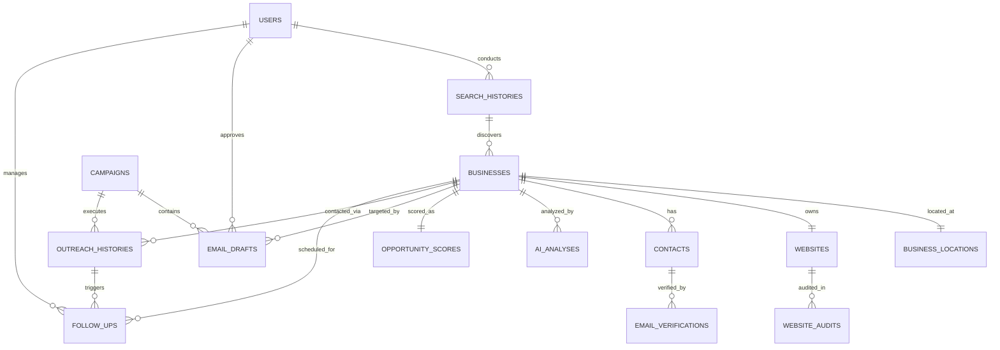

# Database Schema Specification
## LeadForge AI — Complete PostgreSQL Schema & DDL Reference

---

### 1. Entity-Relationship Overview



---

### 2. PostgreSQL DDL Specification

Below is the complete, production-ready PostgreSQL 15+ DDL script including ENUM types, tables, primary keys, foreign keys, constraints, and indexes.

```sql
-- ============================================================================
-- LeadForge AI — Production Database Schema
-- Target Engine: PostgreSQL 15+ (Compatible with Supabase / Neon / AWS RDS)
-- ============================================================================

CREATE EXTENSION IF NOT EXISTS "uuid-ossp";
CREATE EXTENSION IF NOT EXISTS "pgcrypto";

-- ============================================================================
-- 1. ENUM TYPES
-- ============================================================================

CREATE TYPE user_role AS ENUM (
    'ADMIN',
    'OPERATOR',
    'VIEWER'
);

CREATE TYPE search_status AS ENUM (
    'QUEUED',
    'RUNNING',
    'COMPLETED',
    'FAILED'
);

CREATE TYPE discovery_source AS ENUM (
    'GOOGLE_PLACES',
    'OPENSTREETMAP',
    'MANUAL_ENTRY'
);

CREATE TYPE lead_status AS ENUM (
    'DISCOVERED',
    'AUDITED',
    'CONTACT_FOUND',
    'READY_FOR_OUTREACH',
    'OUTREACHED',
    'REPLIED',
    'INTERESTED',
    'MEETING_SCHEDULED',
    'CONVERTED',
    'DISQUALIFIED',
    'UNSUBSCRIBED'
);

CREATE TYPE website_status AS ENUM (
    'NO_WEBSITE',
    'BROKEN_OR_INACTIVE',
    'SOCIAL_ONLY',
    'THIRD_PARTY_DIRECTORY',
    'ACTIVE_OFFICIAL'
);

CREATE TYPE contact_type AS ENUM (
    'EMAIL',
    'PHONE',
    'WHATSAPP',
    'LINKEDIN',
    'INSTAGRAM'
);

CREATE TYPE email_verification_status AS ENUM (
    'VERIFIED_DELIVERABLE',
    'ACCEPT_ALL_UNVERIFIED',
    'DISPOSABLE_REJECTED',
    'NO_MX_RECORDS',
    'INVALID_SYNTAX',
    'UNAVAILABLE'
);

CREATE TYPE draft_status AS ENUM (
    'PENDING_APPROVAL',
    'APPROVED_SCHEDULED',
    'SENT',
    'REJECTED',
    'ARCHIVED'
);

CREATE TYPE outreach_status AS ENUM (
    'QUEUED',
    'SENT',
    'DELIVERED',
    'OPENED',
    'REPLIED',
    'BOUNCED',
    'FAILED'
);

CREATE TYPE outreach_angle AS ENUM (
    'VALUE_GROWTH',
    'TECHNICAL_FLAW_AUDIT',
    'COMPETITOR_COMPARISON',
    'DIRECT_DEMO_OFFER'
);

-- ============================================================================
-- 2. CORE TABLES
-- ============================================================================

-- Table 1: USERS
CREATE TABLE users (
    id UUID PRIMARY KEY DEFAULT uuid_generate_v4(),
    email VARCHAR(255) NOT NULL UNIQUE,
    full_name VARCHAR(100) NOT NULL,
    role user_role NOT NULL DEFAULT 'OPERATOR',
    is_active BOOLEAN NOT NULL DEFAULT TRUE,
    created_at TIMESTAMPTZ NOT NULL DEFAULT NOW(),
    updated_at TIMESTAMPTZ NOT NULL DEFAULT NOW()
);

-- Table 2: SEARCH_HISTORIES
CREATE TABLE search_histories (
    id UUID PRIMARY KEY DEFAULT uuid_generate_v4(),
    user_id UUID REFERENCES users(id) ON DELETE SET NULL,
    source discovery_source NOT NULL DEFAULT 'GOOGLE_PLACES',
    query_country VARCHAR(100) NOT NULL,
    query_state VARCHAR(100),
    query_city VARCHAR(100) NOT NULL,
    query_locality VARCHAR(100),
    query_category VARCHAR(100) NOT NULL,
    query_radius_km NUMERIC(5, 2) NOT NULL DEFAULT 10.00,
    status search_status NOT NULL DEFAULT 'QUEUED',
    total_found INTEGER NOT NULL DEFAULT 0,
    new_leads_imported INTEGER NOT NULL DEFAULT 0,
    error_message TEXT,
    created_at TIMESTAMPTZ NOT NULL DEFAULT NOW(),
    completed_at TIMESTAMPTZ
);

-- Table 3: BUSINESSES
CREATE TABLE businesses (
    id UUID PRIMARY KEY DEFAULT uuid_generate_v4(),
    search_history_id UUID REFERENCES search_histories(id) ON DELETE SET NULL,
    google_place_id VARCHAR(255) UNIQUE,
    dedup_hash VARCHAR(64) NOT NULL UNIQUE,
    name VARCHAR(255) NOT NULL,
    normalized_name VARCHAR(255) NOT NULL,
    primary_category VARCHAR(100) NOT NULL,
    secondary_categories JSONB DEFAULT '[]'::jsonb,
    phone VARCHAR(50),
    normalized_phone VARCHAR(30),
    star_rating NUMERIC(3, 2),
    review_count INTEGER NOT NULL DEFAULT 0,
    price_level INTEGER,
    status lead_status NOT NULL DEFAULT 'DISCOVERED',
    is_claimed BOOLEAN DEFAULT FALSE,
    notes TEXT,
    created_at TIMESTAMPTZ NOT NULL DEFAULT NOW(),
    updated_at TIMESTAMPTZ NOT NULL DEFAULT NOW()
);

-- Table 4: BUSINESS_LOCATIONS
CREATE TABLE business_locations (
    id UUID PRIMARY KEY DEFAULT uuid_generate_v4(),
    business_id UUID NOT NULL UNIQUE REFERENCES businesses(id) ON DELETE CASCADE,
    formatted_address TEXT NOT NULL,
    street_address TEXT,
    locality VARCHAR(100),
    city VARCHAR(100) NOT NULL,
    state VARCHAR(100) NOT NULL,
    country VARCHAR(100) NOT NULL DEFAULT 'India',
    postal_code VARCHAR(20),
    latitude NUMERIC(10, 7),
    longitude NUMERIC(10, 7),
    created_at TIMESTAMPTZ NOT NULL DEFAULT NOW()
);

-- Table 5: WEBSITES
CREATE TABLE websites (
    id UUID PRIMARY KEY DEFAULT uuid_generate_v4(),
    business_id UUID NOT NULL UNIQUE REFERENCES businesses(id) ON DELETE CASCADE,
    raw_url TEXT,
    normalized_url TEXT,
    domain VARCHAR(255),
    status website_status NOT NULL DEFAULT 'NO_WEBSITE',
    social_platform VARCHAR(50),
    is_https BOOLEAN DEFAULT FALSE,
    http_status_code INTEGER,
    final_redirect_url TEXT,
    checked_at TIMESTAMPTZ NOT NULL DEFAULT NOW(),
    updated_at TIMESTAMPTZ NOT NULL DEFAULT NOW()
);

-- Table 6: WEBSITE_AUDITS
CREATE TABLE website_audits (
    id UUID PRIMARY KEY DEFAULT uuid_generate_v4(),
    website_id UUID NOT NULL REFERENCES websites(id) ON DELETE CASCADE,
    performance_score INTEGER,
    accessibility_score INTEGER,
    best_practices_score INTEGER,
    seo_score INTEGER,
    first_contentful_paint_ms INTEGER,
    largest_contentful_paint_ms INTEGER,
    cumulative_layout_shift NUMERIC(5, 3),
    is_mobile_responsive BOOLEAN DEFAULT FALSE,
    cms_detected VARCHAR(100),
    technology_stack JSONB DEFAULT '[]'::jsonb,
    has_viewport_meta BOOLEAN DEFAULT FALSE,
    has_valid_ssl BOOLEAN DEFAULT FALSE,
    ssl_issuer VARCHAR(255),
    raw_audit_json JSONB,
    audited_at TIMESTAMPTZ NOT NULL DEFAULT NOW()
);

-- Table 7: CONTACTS
CREATE TABLE contacts (
    id UUID PRIMARY KEY DEFAULT uuid_generate_v4(),
    business_id UUID NOT NULL REFERENCES businesses(id) ON DELETE CASCADE,
    type contact_type NOT NULL DEFAULT 'EMAIL',
    value VARCHAR(255) NOT NULL,
    first_name VARCHAR(100),
    last_name VARCHAR(100),
    job_title VARCHAR(100),
    source_url TEXT,
    discovery_method VARCHAR(50) NOT NULL DEFAULT 'WEBSITE_CRAWL',
    verification_status email_verification_status NOT NULL DEFAULT 'UNAVAILABLE',
    confidence_score NUMERIC(3, 2) DEFAULT 0.50,
    created_at TIMESTAMPTZ NOT NULL DEFAULT NOW(),
    updated_at TIMESTAMPTZ NOT NULL DEFAULT NOW(),
    CONSTRAINT uq_business_contact UNIQUE (business_id, type, value)
);

-- Table 8: EMAIL_VERIFICATIONS
CREATE TABLE email_verifications (
    id UUID PRIMARY KEY DEFAULT uuid_generate_v4(),
    contact_id UUID NOT NULL REFERENCES contacts(id) ON DELETE CASCADE,
    domain VARCHAR(255) NOT NULL,
    has_valid_mx BOOLEAN NOT NULL DEFAULT FALSE,
    primary_mx_host VARCHAR(255),
    is_disposable BOOLEAN NOT NULL DEFAULT FALSE,
    is_role_account BOOLEAN NOT NULL DEFAULT FALSE,
    smtp_check_performed BOOLEAN DEFAULT FALSE,
    smtp_response TEXT,
    verified_at TIMESTAMPTZ NOT NULL DEFAULT NOW()
);

-- Table 9: AI_ANALYSES
CREATE TABLE ai_analyses (
    id UUID PRIMARY KEY DEFAULT uuid_generate_v4(),
    business_id UUID NOT NULL UNIQUE REFERENCES businesses(id) ON DELETE CASCADE,
    model_used VARCHAR(100) NOT NULL,
    business_summary TEXT NOT NULL,
    identified_niche VARCHAR(100),
    digital_vulnerabilities JSONB NOT NULL DEFAULT '[]'::jsonb,
    suggested_website_features JSONB NOT NULL DEFAULT '[]'::jsonb,
    agency_value_proposition TEXT NOT NULL,
    qualification_status VARCHAR(50) NOT NULL DEFAULT 'QUALIFIED',
    qualification_reason TEXT,
    tokens_input INTEGER NOT NULL DEFAULT 0,
    tokens_output INTEGER NOT NULL DEFAULT 0,
    estimated_cost_usd NUMERIC(8, 5) NOT NULL DEFAULT 0.00000,
    created_at TIMESTAMPTZ NOT NULL DEFAULT NOW()
);

-- Table 10: OPPORTUNITY_SCORES
CREATE TABLE opportunity_scores (
    id UUID PRIMARY KEY DEFAULT uuid_generate_v4(),
    business_id UUID NOT NULL UNIQUE REFERENCES businesses(id) ON DELETE CASCADE,
    total_score INTEGER NOT NULL CHECK (total_score >= 0 AND total_score <= 100),
    website_deficit_score INTEGER NOT NULL CHECK (website_deficit_score >= 0 AND website_deficit_score <= 35),
    commercial_viability_score INTEGER NOT NULL CHECK (commercial_viability_score >= 0 AND commercial_viability_score <= 30),
    contact_accessibility_score INTEGER NOT NULL CHECK (contact_accessibility_score >= 0 AND contact_accessibility_score <= 20),
    agency_fit_score INTEGER NOT NULL CHECK (agency_fit_score >= 0 AND agency_fit_score <= 15),
    breakdown_json JSONB NOT NULL,
    scoring_version VARCHAR(20) NOT NULL DEFAULT 'v1.0',
    calculated_at TIMESTAMPTZ NOT NULL DEFAULT NOW()
);

-- Table 11: CAMPAIGNS
CREATE TABLE campaigns (
    id UUID PRIMARY KEY DEFAULT uuid_generate_v4(),
    user_id UUID REFERENCES users(id) ON DELETE SET NULL,
    name VARCHAR(255) NOT NULL,
    target_city VARCHAR(100),
    target_category VARCHAR(100),
    daily_send_limit INTEGER NOT NULL DEFAULT 35,
    is_active BOOLEAN NOT NULL DEFAULT TRUE,
    created_at TIMESTAMPTZ NOT NULL DEFAULT NOW(),
    updated_at TIMESTAMPTZ NOT NULL DEFAULT NOW()
);

-- Table 12: EMAIL_DRAFTS
CREATE TABLE email_drafts (
    id UUID PRIMARY KEY DEFAULT uuid_generate_v4(),
    business_id UUID NOT NULL REFERENCES businesses(id) ON DELETE CASCADE,
    campaign_id UUID REFERENCES campaigns(id) ON DELETE SET NULL,
    contact_id UUID REFERENCES contacts(id) ON DELETE SET NULL,
    approved_by UUID REFERENCES users(id) ON DELETE SET NULL,
    angle outreach_angle NOT NULL DEFAULT 'VALUE_GROWTH',
    status draft_status NOT NULL DEFAULT 'PENDING_APPROVAL',
    subject_line_options JSONB NOT NULL,
    selected_subject_line TEXT NOT NULL,
    body_markdown TEXT NOT NULL,
    body_html TEXT NOT NULL,
    model_used VARCHAR(100) NOT NULL,
    generation_prompt_hash VARCHAR(64),
    reviewed_at TIMESTAMPTZ,
    scheduled_for TIMESTAMPTZ,
    created_at TIMESTAMPTZ NOT NULL DEFAULT NOW(),
    updated_at TIMESTAMPTZ NOT NULL DEFAULT NOW()
);

-- Table 13: OUTREACH_HISTORIES
CREATE TABLE outreach_histories (
    id UUID PRIMARY KEY DEFAULT uuid_generate_v4(),
    business_id UUID NOT NULL REFERENCES businesses(id) ON DELETE CASCADE,
    draft_id UUID NOT NULL REFERENCES email_drafts(id) ON DELETE CASCADE,
    campaign_id UUID REFERENCES campaigns(id) ON DELETE SET NULL,
    recipient_email VARCHAR(255) NOT NULL,
    sender_email VARCHAR(255) NOT NULL,
    gmail_message_id VARCHAR(255) UNIQUE,
    gmail_thread_id VARCHAR(255),
    status outreach_status NOT NULL DEFAULT 'QUEUED',
    error_message TEXT,
    sent_at TIMESTAMPTZ,
    replied_at TIMESTAMPTZ,
    bounced_at TIMESTAMPTZ,
    created_at TIMESTAMPTZ NOT NULL DEFAULT NOW()
);

-- Table 14: FOLLOW_UPS
CREATE TABLE follow_ups (
    id UUID PRIMARY KEY DEFAULT uuid_generate_v4(),
    business_id UUID NOT NULL REFERENCES businesses(id) ON DELETE CASCADE,
    outreach_history_id UUID REFERENCES outreach_histories(id) ON DELETE CASCADE,
    assigned_user_id UUID REFERENCES users(id) ON DELETE SET NULL,
    due_date DATE NOT NULL,
    is_completed BOOLEAN NOT NULL DEFAULT FALSE,
    notes TEXT,
    completed_at TIMESTAMPTZ,
    created_at TIMESTAMPTZ NOT NULL DEFAULT NOW()
);

-- Table 15: SUPPRESSION_LIST
CREATE TABLE suppression_list (
    id UUID PRIMARY KEY DEFAULT uuid_generate_v4(),
    email_or_domain VARCHAR(255) NOT NULL UNIQUE,
    is_domain BOOLEAN NOT NULL DEFAULT FALSE,
    reason VARCHAR(255) NOT NULL DEFAULT 'UNSUBSCRIBED',
    created_at TIMESTAMPTZ NOT NULL DEFAULT NOW()
);

-- Table 16: API_USAGE_LOGS
CREATE TABLE api_usage_logs (
    id UUID PRIMARY KEY DEFAULT uuid_generate_v4(),
    provider VARCHAR(50) NOT NULL, -- 'OPENROUTER', 'GOOGLE_PLACES', 'PAGESPEED'
    endpoint VARCHAR(255) NOT NULL,
    status_code INTEGER NOT NULL,
    tokens_input INTEGER DEFAULT 0,
    tokens_output INTEGER DEFAULT 0,
    cost_usd NUMERIC(8, 5) DEFAULT 0.00000,
    duration_ms INTEGER NOT NULL,
    error_message TEXT,
    created_at TIMESTAMPTZ NOT NULL DEFAULT NOW()
);

-- Table 17: APP_SETTINGS
CREATE TABLE app_settings (
    key VARCHAR(100) PRIMARY KEY,
    value JSONB NOT NULL,
    description TEXT,
    updated_at TIMESTAMPTZ NOT NULL DEFAULT NOW()
);

-- ============================================================================
-- 3. HIGH-PERFORMANCE INDEXES
-- ============================================================================

-- Businesses Indexes
CREATE INDEX idx_businesses_status ON businesses(status);
CREATE INDEX idx_businesses_category ON businesses(primary_category);
CREATE INDEX idx_businesses_phone ON businesses(normalized_phone);
CREATE INDEX idx_businesses_dedup ON businesses(dedup_hash);

-- Location Indexes
CREATE INDEX idx_business_locations_city_state ON business_locations(city, state);
CREATE INDEX idx_business_locations_country ON business_locations(country);

-- Website Indexes
CREATE INDEX idx_websites_status ON websites(status);
CREATE INDEX idx_websites_domain ON websites(domain);

-- Audit Indexes
CREATE INDEX idx_website_audits_perf ON website_audits(performance_score);
CREATE INDEX idx_website_audits_responsive ON website_audits(is_mobile_responsive);

-- Contact Indexes
CREATE INDEX idx_contacts_email ON contacts(value) WHERE type = 'EMAIL';
CREATE INDEX idx_contacts_status ON contacts(verification_status);

-- Scoring Indexes
CREATE INDEX idx_opportunity_scores_total ON opportunity_scores(total_score DESC);

-- Drafts & Outreach Indexes
CREATE INDEX idx_email_drafts_status ON email_drafts(status);
CREATE INDEX idx_outreach_gmail_thread ON outreach_histories(gmail_thread_id);
CREATE INDEX idx_outreach_status ON outreach_histories(status);

-- Logs & Suppression Indexes
CREATE INDEX idx_suppression_lookup ON suppression_list(email_or_domain);
CREATE INDEX idx_api_logs_provider_created ON api_usage_logs(provider, created_at DESC);
```

---

### 3. Relationships & Data Integrity Safeguards

1. **Cascade Deletes:**
   - Deleting a `Business` cascades cleanly to `BusinessLocation`, `Website`, `Contacts`, `AIAnalysis`, `OpportunityScore`, `EmailDrafts`, and `FollowUps`.
   - Historical audit records and outreach records remain intact or delete according to strict agency data retention rules.
2. **Deduplication Constraints:**
   - `google_place_id` is globally unique.
   - `dedup_hash` (derived from clean name + last 10 digits of phone) prevents re-inserting the same physical business discovered through multiple different search keywords or Overpass coordinates.
3. **Contact Uniqueness:**
   - Unique composite constraint on `(business_id, type, value)` guarantees no duplicate email or phone entries for the same establishment.
