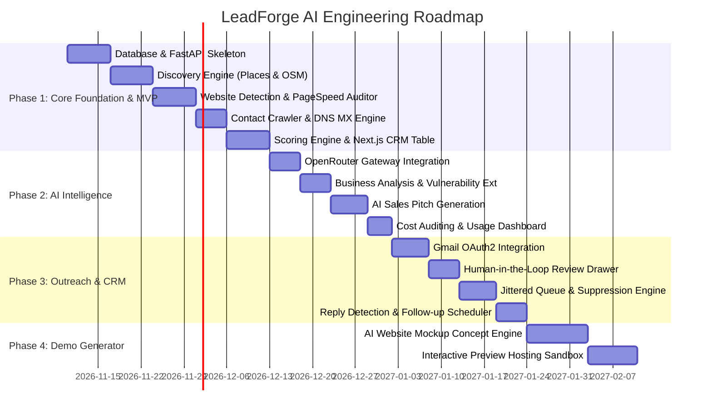

# Development Roadmap & Implementation Plan
## LeadForge AI — Phased Engineering Plan, Milestones & Deliverables

---

### 1. Phased Architecture Overview

---

### 2. Detailed Phase Breakdowns

---

#### Phase 1: Working MVP (Foundation, Discovery, Auditing & Scoring)
- **Objective:** Establish the foundational infrastructure, discover real businesses, inspect their web presence, crawl contact emails, verify DNS MX records, and display scored leads in an interactive dashboard.
- **Key Modules & Deliverables:**
  1. **Monorepo Setup:** Next.js 14+ frontend with Tailwind & shadcn/ui; FastAPI backend with Poetry/Pipenv.
  2. **Database Engine:** PostgreSQL schema initialization with Alembic migrations for core tables (`businesses`, `websites`, `website_audits`, `contacts`, `opportunity_scores`).
  3. **Module A (Discovery):** Google Places API (New) client with field-masking and OSM Overpass fallback.
  4. **Deduplication Engine:** Composite hashing (`google_place_id` and normalized name + phone).
  5. **Module B (Website Detection & Audits):** SSL validation, social domain detection, and Google PageSpeed Insights API client.
  6. **Module D (Contact Discovery):** SSRF-safe HTTP crawler for `/contact` and `/about` pages + async DNS MX resolver (`dnspython`).
  7. **Module E (Scoring):** Deterministic 0–100 scoring algorithm with itemized JSON breakdown.
  8. **Module G (MVP CRM UI):** TanStack Table view with search, category filtering, score badge colors, and CSV export.
- **Estimated Complexity:** Moderate (3–4 weeks).
- **Dependencies:** Google Cloud Project (Places & PageSpeed APIs enabled), Supabase/Neon PostgreSQL, Redis instance.
- **Estimated API Costs:** $0.00 (Covered by Google Cloud $200/mo credit & free PageSpeed tier).
- **Testing Requirements:**
  - Unit tests for SSRF IP filtering (`pytest`).
  - Unit tests for phone & email normalization.
  - Mock API tests for Google Places and PageSpeed responses using `respx` / `pytest-mock`.
- **Deployment Strategy:** Vercel for frontend; Railway/Render Docker container for FastAPI backend and Redis worker.

---

#### Phase 2: AI Intelligence & OpenRouter Integration
- **Objective:** Layer on deep business intelligence and structured sales pitch generation using OpenRouter as the unified AI gateway.
- **Key Modules & Deliverables:**
  1. **OpenRouter Client Core:** Multi-model routing client supporting primary + fallback arrays, timeout management, and exponential backoff retry.
  2. **Model Selection Implementation:** Fast classification using DeepSeek V3 / Gemini 1.5 Flash; deep business reasoning using Claude 3.5 Sonnet / GPT-4o-mini.
  3. **Module C (Business Intelligence):** Automated extraction of digital vulnerabilities, missing revenue drivers, and agency value propositions into validated Pydantic schemas.
  4. **Module F (Email Pitch Generator):** Grounded sales pitch generator producing 3 subject lines, personalized hooks, and Markdown body copy based strictly on verified audit facts.
  5. **Cost & Usage Tracking:** Middleware capturing `x-openrouter-cost`, prompt tokens, and completion tokens into `api_usage_logs` with a real-time expense widget in the UI.
- **Estimated Complexity:** Moderate (2–3 weeks).
- **Dependencies:** OpenRouter API key funded with $10–$20 balance; Phase 1 database operational.
- **Estimated API Costs:** ~$1.50 – $3.50 per 1,000 processed leads.
- **Testing Requirements:**
  - Schema validation testing against mock LLM responses.
  - Anti-hallucination benchmark test suite verifying that no invented numbers or awards pass validation.
- **Deployment Strategy:** In-place backend update; zero database breaking changes.

---

#### Phase 3: CRM Outreach & Gmail Automation
- **Objective:** Connect the agency owner's Google Workspace account via OAuth 2.0, establish a human-in-the-loop email review workflow, and manage controlled outbound outreach.
- **Key Modules & Deliverables:**
  1. **Google OAuth2 Service:** Secure authorization flow storing refresh tokens in AES-256-GCM encrypted database fields.
  2. **Human-in-the-Loop Review UI:** Slide-over drawer in Next.js allowing operators to review, edit, select subject lines, and approve drafts.
  3. **Jittered Outreach Worker:** Background worker dispatching approved emails with randomized intervals (60–180s) and daily volume caps (30–50 emails/day).
  4. **Suppression & Compliance Engine:** Automatic filtering against `suppression_list` before any send; one-click unsubscribe handler.
  5. **Reply Detection & Follow-up Scheduler:** Hourly polling of Gmail threads to identify client responses and automatically pause follow-up sequences.
- **Estimated Complexity:** High (2–3 weeks).
- **Dependencies:** Google Cloud OAuth Consent Screen configured in internal mode; Gmail API enabled.
- **Estimated API Costs:** $0.00 (Included in Google Workspace subscription).
- **Testing Requirements:**
  - End-to-end OAuth token refresh flow tests.
  - Rate limiting & daily send cap boundary condition tests.
  - Unsubscribe suppression filter tests.
- **Deployment Strategy:** Production deployment with strict logging of all outgoing Gmail message IDs.

---

#### Phase 4: Advanced AI Website Demo Concept Generator (Optional Future Phase)
- **Objective:** Give the sales team a competitive edge by automatically generating interactive single-page Tailwind CSS / HTML landing page mockups for qualified prospects.
- **Key Modules & Deliverables:**
  1. **Demo Prompt Architecture:** Advanced Claude 3.5 Sonnet prompt generating semantic HTML5, modern Tailwind CSS, and placeholder imagery tailored to the target's business category (e.g. dynamic hero with booking button for a resort).
  2. **Sandboxed Preview Viewer:** Isolated `iframe` in the frontend dashboard rendering the generated code safely with script-execution restrictions (`sandbox="allow-same-origin"`).
  3. **Shareable Demo Links:** Public read-only preview URL (`/demo/{demo_id}`) with agency branding badge ("Concept preview crafted by YourAgency").
- **Estimated Complexity:** Moderate-to-High (2–3 weeks).
- **Dependencies:** Phase 2 AI engine; S3/Cloudflare R2 bucket for hosting static demo assets.
- **Estimated API Costs:** ~$0.03 – $0.06 per generated demo website.
- **Testing Requirements:**
  - HTML sanitizer testing (preventing XSS in generated demo code).
  - Responsive layout rendering tests across mobile and desktop viewports.
- **Deployment Strategy:** Cloudflare Pages or private S3 bucket with CDN.

---

### 3. Implementation Matrix Summary

| Phase | Core Objective | Timeframe | Tech Complexity | Operational Risk | API Budget |
| :--- | :--- | :--- | :--- | :--- | :--- |
| **Phase 1 (MVP)** | Discovery, Audits, Contacts, Scoring, CRM Table | Weeks 1–4 | Moderate | Low | $0.00 / month |
| **Phase 2 (AI Intelligence)** | OpenRouter Multi-Model Intelligence & Email Drafting | Weeks 5–7 | Moderate | Low | ~$3.00 / month |
| **Phase 3 (Outreach)** | Gmail OAuth, Human Approval, Sending Queue, Reply Sync| Weeks 8–10 | High | Moderate (Deliverability) | $0.00 / month |
| **Phase 4 (Demo Gen)** | AI Landing Page Concept Generator & Preview Sandbox | Weeks 11–13 | Moderate | Low | ~$5.00 / month |
