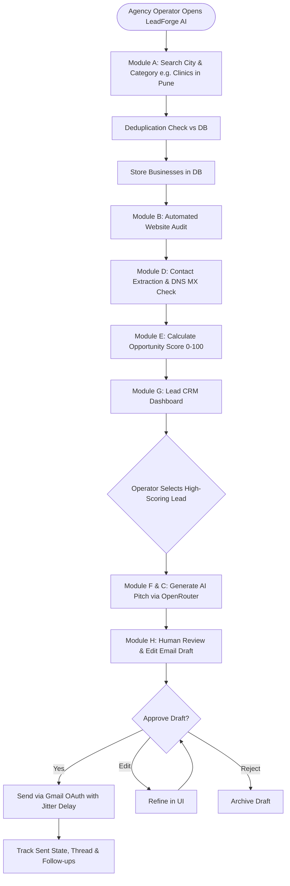

# Product Requirements Document (PRD)
## LeadForge AI — Agency Lead Generation & Business Intelligence Platform

---

### 1. Document Control & Executive Summary

- **Product Name:** LeadForge AI
- **Document Version:** 1.0.0
- **Status:** Approved Architecture Draft
- **Target Audience:** Internal Engineering Team, Agency Owners, Sales Engineers
- **System Classification:** Private Internal SaaS / Agency Operating Platform

#### Executive Summary
**LeadForge AI** is an intelligent, high-precision, low-operating-cost lead discovery and business intelligence platform specifically built for a website development agency. Instead of buying noisy, generic B2B databases, LeadForge AI systematically discovers physical and digital local businesses across targeted geographical sectors (starting in India and architected for global expansion), performs automated multi-dimensional technical audits on their web footprint (or lack thereof), enriches their profile with verified public contacts, calculates an explainable 0–100 Web Opportunity Score, and crafts fact-grounded, non-hallucinatory sales outreach emails via an OpenRouter AI orchestration pipeline.

---

### 2. Market Problem & Agency Value Proposition

#### The Problem
1. **Generic B2B Scrapers Are Ineffective for Web Agencies:** Tools like Apollo or ZoomInfo index corporate tech firms, software companies, and venture-backed startups. They fail to effectively capture local commercial establishments (clinics, resorts, academies, boutique retailers, fitness chains) that urgently need modern websites, e-commerce stores, and booking engines.
2. **"Blind" Cold Outreach Has Low Conversion:** Generic pitch templates ("Hey, do you need a website?") have sub-1% reply rates because they don't reference the client's actual broken features, missing mobile viewports, zero HTTPS security, or missing Google Business links.
3. **High Subscription Overhead:** Typical agency stacks stitch together 5–7 disparate paid tools (scraping tools, Hunter/Snov subscriptions, website checkers, separate OpenAI plans, CRM fees), yielding $400–$800/month in baseline SaaS costs before a single client is won.
4. **Data Hallucination & Reputation Risk:** Unchecked AI generators invent fake customer reviews, non-existent products, or offensive claims, damaging agency reputation upon sending.

#### LeadForge AI Solution
- **Localized Discovery:** Combines Google Places API / OpenStreetMap to find real, active businesses with high customer footfall but inadequate web presence.
- **Evidence-Based Technical Audits:** Automates mobile responsiveness, HTTPS verification, Core Web Vitals (via PageSpeed Insights API), and social-vs-official URL detection.
- **Explainable Opportunity Scoring:** Separates *operational prosperity* (high footfall, 500+ Google reviews) from *digital weakness* (no website or slow mobile page), targeting businesses with the budget and need to pay for web development.
- **Consolidated AI via OpenRouter:** Uses a single, flexible AI gateway with model tiering (fast low-cost models for classification; advanced reasoning models for intelligence and hyper-personalized emails).
- **Human-in-the-Loop CRM & Outreach:** Review-and-approve pipeline connected directly to agency Gmail via Google OAuth for optimal inbox deliverability.

---

### 3. Target Verticals & Geographic Scope

#### 3.1 Initial Launch Geography
- **Primary Market:** India (Tier 1 & Tier 2 Cities: Mumbai, Delhi NCR, Bengaluru, Hyderabad, Pune, Chennai, Ahmedabad, Kolkata, Jaipur, Chandigarh, Surat, Kochi, Lucknow).
- **Expansion Architecture:** Parameterized country, state, city, and geolocation radius filters to enable seamless rollout across GCC (UAE, Saudi Arabia), Southeast Asia, the UK, Australia, and North America.

#### 3.2 Target Business Categories & Opportunity Profiles

| Category | Typical Digital Vulnerability | High-Value Agency Offer |
| :--- | :--- | :--- |
| **Clinics & Hospitals** | Outdated static sites, missing appointment booking, zero mobile optimization | Online consultation booking system, HIPAA/DPDPA compliant patient portal, doctor schedules |
| **Hotels & Resorts** | Heavy reliance on OTAs (MakeMyTrip, Booking.com) paying 15-25% commissions | Direct booking engine, virtual 360 tour, event/wedding enquiry capture |
| **Restaurants & Cafes** | Relying purely on Zomato/Swiggy or Instagram bio links; missing digital menus | Custom brand site, commission-free direct ordering/pickup, table reservation system |
| **Coaching Institutes & Academies** | PDF brochures, no course landing pages, poor inquiry forms | Student lead-funnels, LMS integration, fee payment gateway integration |
| **Gyms & Fitness Centers** | Instagram only, no membership management or class scheduling | Class timetable, trial pass booking, recurring subscription payments |
| **Salons & Spas** | Missing real-time slot scheduling; fragmented WhatsApp booking | Automated slot booking, service showcase, stylist portfolio |
| **Real Estate Agencies** | Poor property listings, slow load times, unoptimized search | Property catalog with filter search, WhatsApp CRM integration, virtual tour embedding |
| **Local Retailers & Boutiques** | No digital catalog; unorganized WhatsApp product sharing | Shopify/WooCommerce store, local delivery picker, catalog showcase |

---

### 4. Feature Specifications (Modules A through I)

#### Module A: Business Discovery Engine
- **A1. Geographic Filter Hierarchy:** Country -> State/Region -> City/District -> Locality/Pincode -> Radius (1 km to 50 km).
- **A2. Multi-Provider Discovery:**
  - *Primary Source:* Google Places API (New Text Search & Nearby Search).
  - *Zero-Cost / Fallback Source:* OpenStreetMap via Overpass API for bulk node retrieval without API credit depletion.
- **A3. Extracted Attributes:** Business Name, Normalized Address, Coordinates (Lat/Lng), Primary & Secondary Categories, Star Rating, Total Review Count, Price Level, Primary Phone, Google Maps CID/Place ID, Listed Website URL.
- **A4. Deduplication Engine:** Composite unique constraint combining `normalized_name + normalized_phone` and `google_place_id` to prevent redundant records and re-billing.
- **A5. Search History & Pagination:** Asynchronous cursor-based pagination tracking; searches are saved with query params, timestamp, and result counts.

#### Module B: Website Detection & Technical Auditor
- **B1. Website Categorization Matrix:**
  - `NO_WEBSITE`: No URL listed anywhere in registry.
  - `BROKEN_OR_INACTIVE`: Listed URL returns DNS resolution failure, connection timeout, 4xx, or 5xx HTTP response.
  - `SOCIAL_ONLY`: Listed URL points to Facebook, Instagram, LinkedIn, Justdial, Indiamart, Zomato, or Linktree.
  - `THIRD_PARTY_DIRECTORY`: Listed URL points to an unowned local listing page.
  - `ACTIVE_OFFICIAL`: Resolves to a distinct company domain.
- **B2. Evidence-Based Audit Engine:**
  - Automated check of SSL/HTTPS certificate validity.
  - Mobile responsiveness verification (viewport meta tag, responsive container indicators).
  - PageSpeed Insights integration: Performance, Accessibility, Best Practices, and SEO scores (0–100 scale).
  - Technology stack inspection: CMS detection (WordPress, Wix, Squarespace, custom HTML, outdated PHP).
  - Obsolete design heuristics: Missing favicon, dated copyright year (e.g. `<= 2021`), non-responsive desktop layouts.

#### Module C: Business Intelligence & Prospect Evaluation
- **C1. LLM Context Ingestion:** Ingests business name, category, review summaries, rating, presence/quality of website, social profiles, and phone presence.
- **C2. Core Analytical Outputs:**
  - Business Summary: Concise 2-sentence synopsis of what the business does and who its customers are.
  - Missing Revenue Drivers: Identifies absent web features (e.g., direct booking, lead form, digital menu, portfolio).
  - Web Development Proposition: Concrete value proposition tailored to their business model.
  - Prospect Qualification: Binary qualification (`QUALIFIED`, `MARGINAL`, `DISQUALIFIED`) with rationale.
- **C3. Single Gateway Processing:** Uses OpenRouter API with structured JSON output enforcement (`response_format: { type: "json_object" }`).

#### Module D: Contact Discovery & Verification
- **D1. Legitimate Discovery Pipeline:**
  - Deep crawl of official business website: scans homepage, `/contact`, `/contact-us`, `/about`, `/about-us`, and footer.
  - Regular expression extraction of public `mailto:` links and email text.
  - Clean regex sanitization filtering out image file extensions (e.g., `user@domain.png`), generic placeholder emails (`example@email.com`), and webmaster assets.
- **D2. Contact Metadata & Provenance:**
  - Every email stores: Email Address, First Name / Department (if detected), Source URL, Discovery Method (`WEBSITE_CRAWL`, `MANUAL_ENTRY`), Discovery Timestamp.
- **D3. Multi-Layer Verification:**
  - *Syntax Verification:* RFC 5322 compliance check.
  - *Domain & DNS MX Verification:* Direct asynchronous lookup of active Mail Exchange records (e.g., Google Workspace, Microsoft 365, generic MX).
  - *Disposable Email Detection:* Blocklist checking against temporary email hosts.
  - *Verification Statuses:* `VERIFIED_DELIVERABLE`, `ACCEPT_ALL_UNVERIFIED`, `INVALID_DOMAIN`, `NO_MX_RECORDS`, `UNAVAILABLE`.
  - *Zero Hallucination Rule:* The AI service is strictly forbidden from guessing, completing, or predicting email addresses.

#### Module E: Explainable AI Lead Scoring (0–100)
- **E1. Scoring Formula Components:**
  - **Website Deficit Score (0–35 pts):** No website = 35 pts; Social media only = 30 pts; Broken website = 28 pts; Poor mobile/speed score (< 40) = 22 pts; Outdated tech = 15 pts; Modern fast website = 0 pts.
  - **Business Commercial Viability (0–30 pts):** Review count > 100 = 15 pts (50–100 = 10 pts; 10–50 = 5 pts); Star rating >= 4.0 = 10 pts; Complete physical profile (phone + verified location) = 5 pts. *(Ensures the business is actively trading and generating revenue).*
  - **Contact Accessibility (0–20 pts):** Verified email found = 15 pts; Phone number present = 5 pts; No contact = 0 pts.
  - **Agency Service Fit (0–15 pts):** High-ticket category (Hotels, Hospitals, Real Estate, Coaching) = 15 pts; Mid-ticket (Clinics, Gyms, Spas) = 10 pts; Low-ticket micro-retail = 5 pts.
- **E2. Transparency Requirement:** Every lead displays an exact itemized breakdown of how its score was calculated (e.g., `[Website Deficit: 35] + [Viability: 25] + [Contact: 15] + [Fit: 15] = 90/100`).

#### Module F: AI Sales Email Generator
- **F1. Business Grounding:** Generates personalized outreach referencing only verified business attributes (city, category, rating, specific website flaws detected).
- **F2. Tone & Angle Variations:**
  - *Angle 1: Value / Growth Focus* (Emphasis on missed customer leads, direct revenue, SEO ranking).
  - *Angle 2: Technical Flaw / Direct Audit* (Polite, objective alert regarding broken mobile layout, slow loading, or non-HTTPS warning).
  - *Angle 3: Modern Competitor Comparison* (Polite comparison to modern peer standards in their local city).
- **F3. Structural Components:**
  - Punchy, high-open subject lines (3 options generated).
  - Personalized hook referencing real business context.
  - Specific, low-friction observation (no generic insults).
  - Value proposition showing concrete agency solution.
  - Clear, zero-pressure Call to Action (e.g., "Open to seeing a 2-minute video mockup of how your booking flow could look?").

#### Module G: Agency Lead CRM
- **G1. Funnel States:**
  - `DISCOVERED` -> `AUDITED` -> `CONTACT_FOUND` -> `READY_FOR_OUTREACH` -> `OUTREACHED` -> `REPLIED` -> `INTERESTED` -> `MEETING_SCHEDULED` -> `CONVERTED` -> `DISQUALIFIED` / `UNSUBSCRIBED`.
- **G2. Interactive Workflow:**
  - Advanced data table with search, category filtering, score sliders, and city filtering.
  - Lead drawer detailing full audit, contact history, email drafts, and manual notes.
  - Follow-up date scheduling with calendar/inbox notification reminders.
  - Full CSV/JSON data export for external use or backups.

#### Module H: Email Campaign & Outreach Management
- **H1. Google OAuth2 Integration:** Connects the agency owner's legitimate Google Workspace / Gmail account using `gmail.send` and `gmail.compose` scopes.
- **H2. Human-in-the-Loop Safeguards:** All generated emails enter an `EMAIL_DRAFT` state. No automated email leaves the system without explicit agency operator approval.
- **H3. Safety & Deliverability Controls:**
  - Daily sending throttle (configurable limit: default 30–50 emails/day to maintain pristine domain reputation).
  - Inter-email random delays (60–180 seconds jitter between sent messages).
  - Global Suppression List: Records unsubscribed domains and emails, preventing future outreach across all campaigns.
  - Automatic thread tracking: Detects client replies via Gmail thread ID to immediately pause follow-up sequences.

#### Module I: AI Website Demo Concept Generator (Optional Phase 4)
- **I1. Concept:** Automatically produces an interactive single-page HTML/Tailwind preview mockup based on the business's branding, category, and audit findings.
- **I2. Agency Asset:** Enables the sales rep to send a personalized preview link ("We built a demo preview for your resort: [Demo Link]") which dramatically boosts cold conversion rates.

---

### 5. Non-Functional Requirements (NFRs)

1. **Performance:**
   - Business discovery query time: < 3 seconds for cached or paginated API searches.
   - Website technical audit runtime: < 15 seconds per target site (with 10-second hard connection timeout).
   - AI generation turnaround: < 5 seconds per email draft via streaming or optimized JSON prompting.
2. **Security & Data Privacy:**
   - Encrypted storage for all OAuth refresh tokens and API secrets using AES-256-GCM.
   - Anti-SSRF (Server-Side Request Forgery) protection on the website crawler to prevent internal network scanning.
   - Full compliance with the Digital Personal Data Protection Act (DPDP Act 2023 - India) and international anti-spam standards (CAN-SPAM).
3. **Availability & Reliability:**
   - 99.5% uptime for the private web application.
   - Idempotent API operations: retrying failed lead enrichments without creating duplicate rows or billing cycles.
4. **Usability:**
   - Dark/Light modern dashboard built on Next.js 14+ and shadcn/ui.
   - Responsive layouts optimized for desktop operations (primary) and tablet monitoring (secondary).

---

### 6. User Journeys & Operational Workflows

