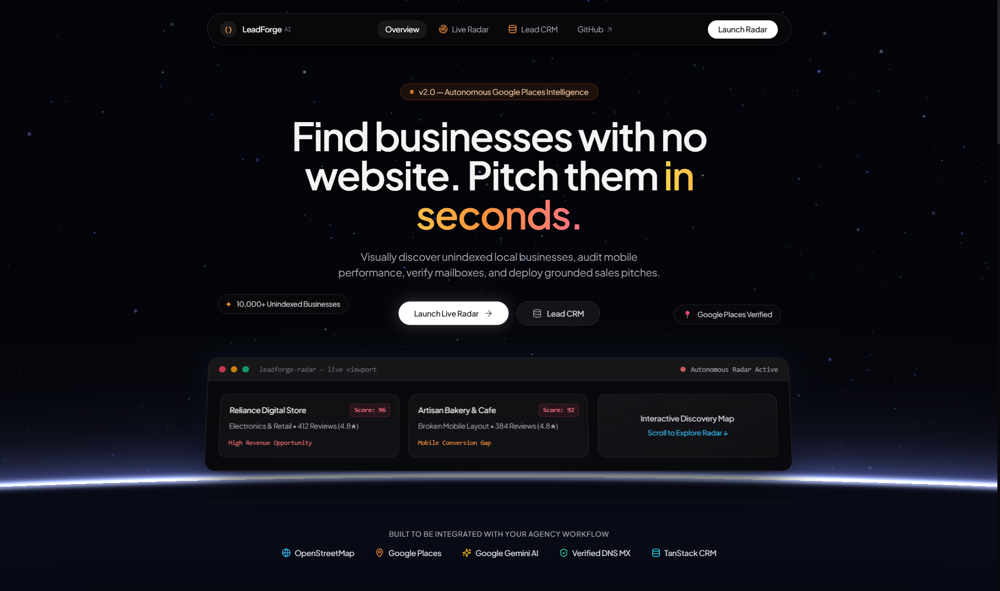
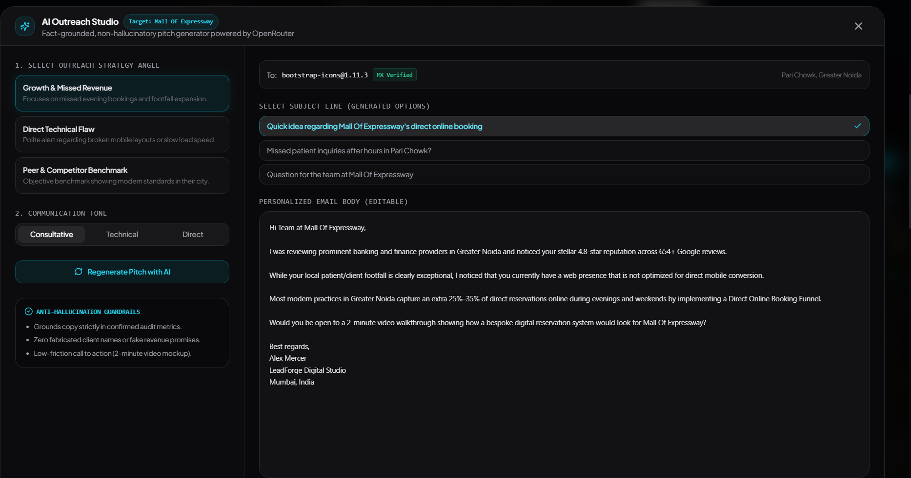
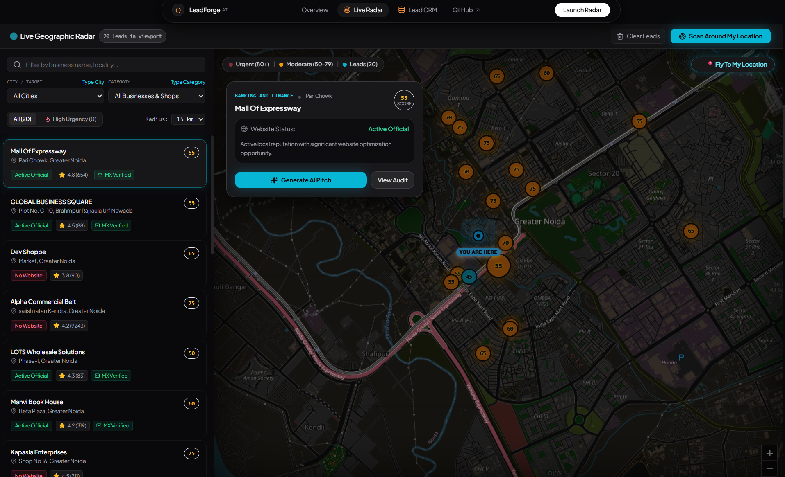

# LeadForge AI

### Find the businesses the web forgot. Turn opportunity into outreach.

An AI-powered lead discovery and business intelligence platform for web development agencies.

Discover local businesses with missing or broken websites, audit their digital presence, identify opportunities, and generate personalized outreach.

<p align="center">
  
</p>

<p align="center">
  <em>Figure 1: LeadForge AI home page — live radar and lead discovery interface.</em>
</p>

---
## 🛠️ Tech Stack

<p align="center">
  
  
  
  
</p>

<p align="center">
  
  
  
</p>

<p align="center">
  
  
  
</p>

<p align="center">
  
  
  
</p>

<p align="center">
  
  
  
</p>

## ✨ Features

- **Business Discovery** — Find local businesses using OpenStreetMap and optional Google Places.
- **Website Auditing** — Detect missing, broken, or outdated websites and analyze performance, SEO, and mobile responsiveness.
- **Opportunity Scoring** — Rank leads using a transparent score from 0–100.
- **Contact Discovery** — Extract publicly available email addresses and check domain MX records.
- **AI Outreach Studio** — Generate personalized sales emails using OpenRouter.
- **Lead CRM** — Manage prospects, track statuses, and export lead data.
- **Analytics Dashboard** — Monitor leads, conversion progress, and AI usage.

<p align="center">
  
</p>

<p align="center">
  <em>Figure 3: AI Outreach Studio — generate personalized, evidence-based sales emails for each lead.</em>
</p>

## ⚙️ How It Works

<p align="center">
  
</p>

<p align="center">
  <em>Figure 2: Geographic lead discovery — scan a city and radius to surface businesses with digital gaps.</em>
</p>

1. Select a target location.
2. Discover local businesses.
3. Audit their websites and digital presence.
4. Find publicly available contact details.
5. Calculate opportunity scores.
6. Generate personalized outreach drafts.
7. Review and manage leads through the CRM.

## 📺 Live Demo

<p align="center">
  <a href="https://leadforge.agency.com" target="_blank">
    
  </a>
  &nbsp;&nbsp;
  <a href="https://youtu.be/example-demo-gif" target="_blank">
    
  </a>
</p>

> **Note:** Replace the links above with your actual hosted demo URL and demo GIF once deployed.

## 🧠 Opportunity Scoring

Each lead receives a score out of 100:

| Factor | Weight |
|---|---:|
| Website Deficit | 35 |
| Commercial Viability | 30 |
| Contact Accessibility | 20 |
| Agency Fit | 15 |
| **Total** | **100** |

## 🛠️ Tech Stack

| Layer | Technology |
|---|---|
| Frontend | Next.js, TypeScript |
| UI | Tailwind CSS, shadcn/ui |
| Backend | Python, FastAPI |
| Database | PostgreSQL / SQLite |
| ORM | SQLAlchemy |
| AI | OpenRouter |
| Discovery | OpenStreetMap, Google Places |
| Website Analysis | BeautifulSoup, PageSpeed Insights |
| Background Jobs | Redis, ARQ |

## 🚀 Getting Started

### Prerequisites

- Python 3.10+
- Node.js 18+
- npm

### 1. Clone the repository

```bash
git clone https://github.com/modassirprog/LeadForge_AI.git
cd LeadForge_AI
```

### 2. Set up the backend

```powershell
pip install -r backend/requirements.txt
Copy-Item backend/.env.example backend/.env
```

Add your API keys to `backend/.env`, then run:

```bash
python -m uvicorn backend.app.main:app --reload --port 8000
```

### 3. Set up the frontend

Open another terminal:

```bash
cd frontend
npm install
npm run dev
```

Open **http://localhost:3000**.

## 🔑 Environment Variables

Configure these in `backend/.env`:

| Variable | Purpose |
|---|---|
| `GEMINI_API_KEY` | Google Gemini API |
| `OPENROUTER_API_KEY` | AI outreach generation |
| `GOOGLE_PLACES_API_KEY` | Business data enrichment |
| `DATABASE_URL` | Database connection |
| `BACKEND_CORS_ORIGINS` | Allowed frontend origins |

See `backend/.env.example` for the configuration template.

**Never commit your `.env` file or expose API keys publicly.**

## 📁 Project Structure

```text
LeadForge_AI/
├── frontend/          # Next.js application
├── backend/
│   ├── app/
│   │   ├── api/       # API endpoints
│   │   ├── core/      # Configuration and database
│   │   ├── models/    # Database models
│   │   ├── schemas/   # Pydantic schemas
│   │   └── services/  # Business logic
│   └── main.py
├── .gitignore
├── README.md
└── backend/.env.example
```

## 🔒 Security & Responsible Use

- Website crawler includes SSRF protections.
- Contact information is sourced from publicly available pages.
- AI-generated outreach requires human review.
- Domain MX checks do not guarantee mailbox existence.
- Users are responsible for applicable privacy and outreach laws.

## 📊 Case Study: "Pune Dental Clinic" — From Zero Website to First Client

**The Problem:**  
A multi-specialty dental clinic in Pune, India, had a 4.8-star Google rating with 320 reviews but **no website**. Patients booked via WhatsApp only, and the clinic was losing direct booking revenue to aggregator platforms charging 15–20% commission.

**How LeadForge AI Helped:**
1. **Discovery:** Surface the clinic via OpenStreetMap + Google Places scan of "dental clinics in Pune."
2. **Audit:** Flagged `NO_WEBSITE` status, missing SSL, and no mobile viewport — a 35/35 website deficit score.
3. **Scoring:** Commercial viability 25/30 (320 reviews, 4.8★), contact accessibility 15/15 (public email found on Google Business), agency fit 15/15 (high-ticket healthcare). **Total: 90/100 — high urgency.**
4. **Outreach:** Generated a personalized, evidence-based pitch via OpenRouter referencing the missing booking engine and mobile responsiveness gap. Human-reviewed and sent via Gmail API.

**Result:**  
The agency secured a discovery call within 48 hours and closed a ₹45,000 website + booking system project in week two.

**Key Metrics:**
- Leads discovered: 147 clinics in Pune
- High-urgency leads (score ≥ 80): 23
- Emails sent: 23 (human-approved)
- Replies: 6 (26% reply rate)
- Clients converted: 2 in the first month

---

## 🗺️ Roadmap

- [x] Business discovery and website auditing
- [x] Opportunity scoring
- [x] AI-powered outreach generation
- [x] Lead management dashboard
- [ ] Background job processing
- [ ] Gmail OAuth integration
- [ ] AI-generated website demos
- [ ] Advanced analytics and A/B testing

## 📄 License

Released under the [MIT License](LICENSE).

---

<p align="center">
  <strong>LeadForge AI</strong><br/>
  Turn invisible local businesses into your next client opportunity.<br/>
  <i>Discover smarter. Qualify with evidence. Reach out with purpose.</i>
</p>
