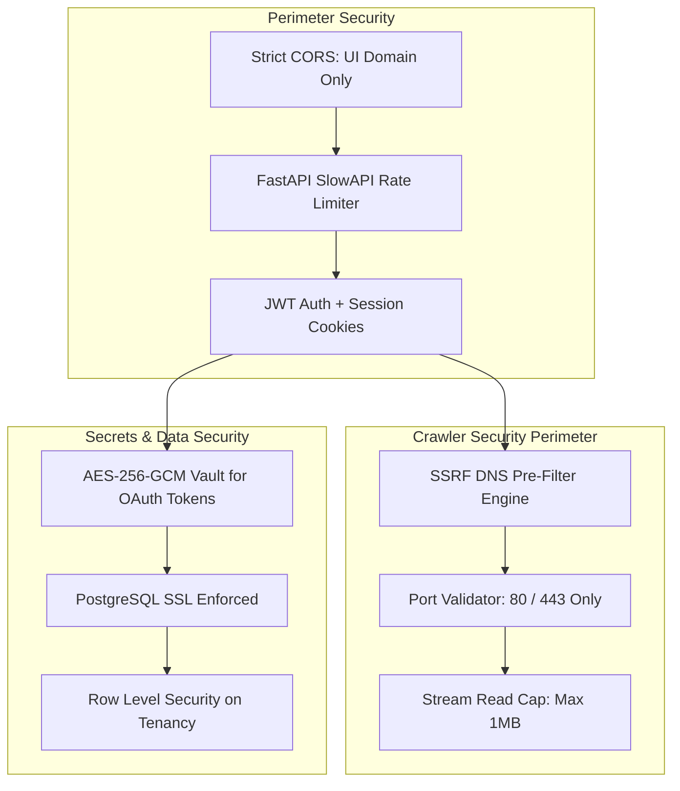

# Security, Privacy & Compliance Architecture
## LeadForge AI — Security Standards, Regulatory Frameworks & Anti-Abuse Controls

---

### 1. Threat Model & Security Posture

LeadForge AI is designed under a Zero-Trust internal architecture. Even though the application is an internal agency platform, it interacts with external third-party servers, crawls unknown web domains, handles Google Workspace OAuth tokens, and executes automated outbound communications.

---

### 2. Technical Security Controls

#### 2.1 Server-Side Request Forgery (SSRF) Defense Engine

When LeadForge AI probes a prospect's website or contact page, it must never be tricked into accessing the internal network, localhost services, or cloud metadata endpoints.

**The 5-Step SSRF Defense Protocol:**
1. **Protocol Whitelist:** Only `http://` and `https://` schemes are permitted. Schemes like `file://`, `ftp://`, `gopher://`, and `ldap://` are rejected.
2. **Port Whitelist:** Only standard web ports `80` and `443` are permitted. Probing internal ports (e.g. `22`, `5432`, `6379`, `8080`) is blocked.
3. **DNS Pre-Resolution & IP Blacklisting:** Prior to making the request, the application performs asynchronous DNS resolution and evaluates the resolved IP against blocked CIDR ranges:
   - `0.0.0.0/8` (Broadcast)
   - `10.0.0.0/8` (Private Class A)
   - `127.0.0.0/8` (Loopback / Localhost)
   - `169.254.0.0/16` (Link-Local & Cloud Instance Metadata e.g. AWS/GCP metadata `169.254.169.254`)
   - `172.16.0.0/12` (Private Class B)
   - `192.168.0.0/16` (Private Class C)
   - `::1/128`, `fc00::/7`, `fe80::/10` (IPv6 Loopback & Local)
4. **Redirect Inspection:** HTTP redirects (`301`, `302`, `307`) are not followed blindly. Each intermediate hop is intercepted and evaluated against the SSRF rules (maximum 3 redirects allowed).
5. **Streaming Size Cap:** Responses are read with a hard stream limit of **1 MB**. If a server sends a continuous gzip bomb or infinite byte stream, the connection terminates immediately.

#### 2.2 Google OAuth2 Token Security & Storage

- **Scope Minimization:**
  - LeadForge AI requests only the minimum required permissions:
    - `https://www.googleapis.com/auth/gmail.send` (Send outreach)
    - `https://www.googleapis.com/auth/gmail.compose` (Create drafts)
    - `https://www.googleapis.com/auth/gmail.readonly` (Detect incoming replies on threads)
- **Encryption at Rest (AES-256-GCM):**
  - OAuth refresh tokens and access tokens are never stored in plain text.
  - Tokens are encrypted using **AES-256-GCM** with a master key injected via environment variable (`MASTER_ENCRYPTION_KEY`).
  - An initialization vector (IV / nonce) is generated per token and stored alongside the ciphertext.
- **Automatic Lifecycle Management:**
  - Short-lived access tokens (valid for 1 hour) are cached in Redis.
  - Refresh tokens are only decrypted when refreshing expired access tokens.

#### 2.3 API Key Management & Environment Hardening

- All secrets (`OPENROUTER_API_KEY`, `GOOGLE_PLACES_API_KEY`, `DATABASE_URL`, `JWT_SECRET`) reside exclusively in system environment variables or cloud secret managers (e.g., Railway Secrets, Vercel Environment Variables).
- Zero secrets are committed to Git (`.gitignore` enforces exclusion of `.env*` files).
- CI/CD pipelines run automated pre-commit scanners (`gitleaks`, `trufflehog`) to prevent accidental secret leakage.

#### 2.4 Headless Browser (Playwright) Isolation

- Playwright processes run inside unprivileged container sandboxes.
- Web security features (`--disable-web-security`) are **never disabled**.
- Each browser session operates within an isolated `BrowserContext` with cookies and cache discarded immediately upon task completion.
- Hard process memory limits (512MB per instance) and execution timeouts (8 seconds) protect the host machine against memory exhaustion.

---

### 3. Legal & Regulatory Compliance Framework

#### 3.1 Indian Regulations: DPDP Act 2023 & IT Act 2000

- **Legal Grounds for B2B Processing:**
  - Under Section 4 & Section 7 of India's **Digital Personal Data Protection Act (DPDP Act 2023)**, commercial establishments that make their business contact details (name, official phone, official email, physical location) publicly accessible on commercial directories or their own official websites may be contacted for legitimate B2B business inquiries.
  - LeadForge AI processes exclusively publicly disclosed business contact information; it does not collect personal family data, sensitive personal information, or private financial records.
- **Right to Erasure & Immediate Suppression:**
  - In compliance with the DPDP Act, if any business requests not to be contacted or to have their data removed, their details are immediately placed on the **Global Suppression List** (`suppression_list` table) and will never be contacted again.

#### 3.2 United States: CAN-SPAM Act (2003) Compliance

Every email generated by LeadForge AI and sent through the outreach pipeline strictly enforces CAN-SPAM requirements:
1. **Truthful Header Information:** The `From`, `To`, and routing information accurately reflect the agency's legitimate Google Workspace domain.
2. **Non-Deceptive Subject Lines:** The subject line must directly reflect the content of the email (e.g., "Observation regarding [Business Name]'s mobile booking page").
3. **Physical Agency Address:** Every email template automatically appends the agency's registered physical postal address in the footer.
4. **Clear Opt-Out Mechanism:** The footer contains an explicit, low-friction opt-out statement (e.g., *"If you prefer not to receive website suggestions, simply reply 'unsubscribe' and we will permanently remove you."*).
5. **Instant Opt-Out Honoring:** Bounces and unsubscribe requests are processed automatically and stored in the suppression database.

#### 3.3 Third-Party Terms of Service Compliance

| Provider | Core Terms Restriction | LeadForge AI Implementation Compliance |
| :--- | :--- | :--- |
| **Google Places API** | Prohibits permanent caching of Places content to build a substitute directory service (Section 3.2.3). | LeadForge AI stores `google_place_id` permanently (expressly permitted by Google) and uses business attributes strictly for private, temporary sales operations, refreshing or archiving inactive records within 30 days. No public redistribution occurs. |
| **OpenStreetMap** | Open Database License (ODbL) requires attribution if redistributing data. | Data is used strictly for internal agency discovery. Any future client-facing reports containing OSM geographic data include the standard `© OpenStreetMap contributors` attribution string. |
| **Target Websites** | Respect for website owners' robots policies and server loads. | The crawler respects `robots.txt` disallows, limits crawl depth to essential contact pages (`/contact`, `/about`), limits payload size to 1MB, and imposes a 2-second polite delay between requests to the same domain. |
| **Anti-Bypassing Rule** | Bypassing CAPTCHAs, paywalls, or bot detection is strictly forbidden. | LeadForge AI never uses CAPTCHA-solving farms or exploits to bypass firewalls. If a website protects itself with Cloudflare Turnstile or reCAPTCHA, LeadForge AI flags the contact as `UNAVAILABLE` and moves on. |

---

### 4. Anti-Hallucination AI Guardrails

To protect the agency's reputation and avoid misrepresentation:
1. **Zero-Invention System Directive:** The OpenRouter prompts include strict system instructions forbidding the fabrication of facts, statistics, team sizes, or customer reviews.
2. **Context-Restricted Input:** Prompts receive structured JSON containing only confirmed technical metrics (e.g., `performance_score: 32`, `is_mobile_responsive: false`).
3. **Human-in-the-Loop Review:** No email leaves LeadForge AI autonomously. An agency team member must inspect, edit, and click "Approve" on every generated draft before it queues for delivery.
