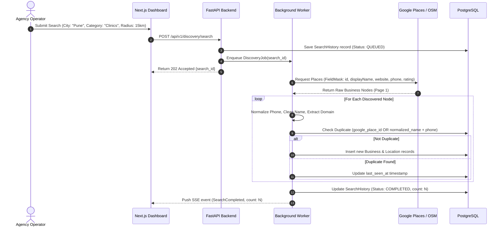
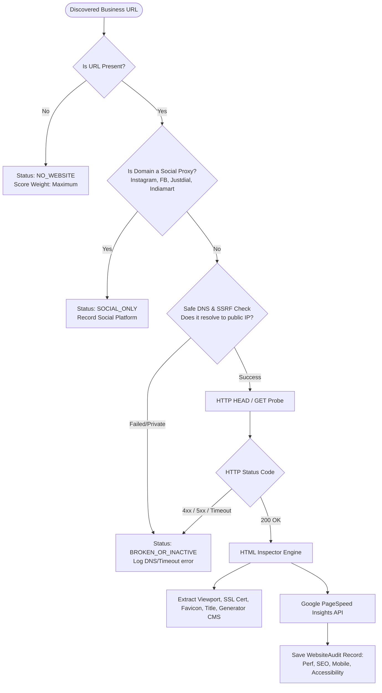
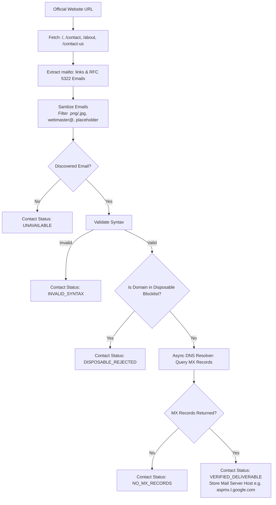
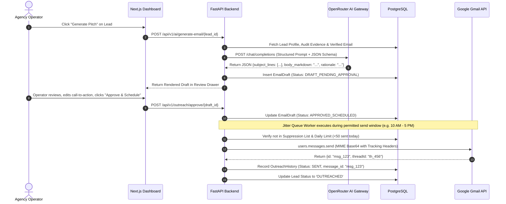

# System Architecture Specification
## LeadForge AI — Core System Design, Pipelines & Data Flow

---

### 1. High-Level Architectural Blueprint

LeadForge AI is structured as a modular, decoupled system comprising a high-performance **Next.js (App Router) Frontend**, an asynchronous **Python FastAPI Core Service**, an asynchronous **Background Worker Pool (ARQ / Redis)**, a persistent **PostgreSQL Relational Database**, and the **OpenRouter Unified AI Gateway**.

```mermaid
flowchart TB
    subgraph Client Application
        UI[Next.js 14 Dashboard<br/>React + TypeScript + shadcn/ui]
    end

    subgraph API Gateway & Core Backend
        FastAPI[FastAPI Application Server<br/>Async I/O + Pydantic v2]
        AuthGuard[JWT & Session Security Guard]
        RateLimiter[Token Bucket & Concurrency Limiter]
    end

    subgraph Async Processing & Message Queue
        RedisQueue[(Redis 7.x Queue & Cache)]
        Worker[ARQ Async Worker Fleet<br/>Scraping, Auditing, AI Processing]
    end

    subgraph Data Tier
        Postgres[(PostgreSQL 15+ DB<br/>Relational Schema + JSONB)]
    end

    subgraph External System Integrations
        GooglePlaces[Google Places API (New)]
        OSM[OpenStreetMap Overpass API]
        PageSpeed[Google PageSpeed Insights API]
        OpenRouter[OpenRouter AI Gateway]
        TargetWebsites[Target Business Web Servers]
        GmailService[Google Workspace / Gmail API]
    end

    UI <-->|HTTPS / REST & Server-Sent Events| FastAPI
    FastAPI --> AuthGuard --> RateLimiter
    RateLimiter --> Postgres
    FastAPI -->|Enqueue Jobs| RedisQueue
    RedisQueue --> Worker
    Worker --> Postgres
    Worker -->|Discovery Query| GooglePlaces
    Worker -->|Fallback Query| OSM
    Worker -->|Lighthouse Performance| PageSpeed
    Worker -->|SSRF-Safe HTTP Crawl| TargetWebsites
    Worker -->|Structured LLM Invocations| OpenRouter
    Worker -->|OAuth2 Jittered Sending| GmailService
```

---

### 2. Detailed Pipeline Specifications

---

#### 2.1 Module A: Discovery & Deduplication Pipeline



- **Deduplication Logic:**
  1. Primary check: `google_place_id` (Unique key).
  2. Secondary check: `MD5(LOWER(REGEXP_REPLACE(name, '[^a-z0-9]', '')) + RIGHT(REGEXP_REPLACE(phone, '[^0-9]', ''), 10))`.
  3. Prevents re-auditing existing leads and prevents duplicate outreach across multiple team searches.

---

#### 2.2 Module B: Website Detection & Technical Auditor Pipeline

The auditor determines whether the business has a real digital asset, a social proxy, or no web presence, and measures its performance.



- **URL Normalization Rules:**
  - Standardizes raw inputs: `http://example.com/` -> `https://example.com`.
  - Removes tracking parameters (`?utm_source=...`, `?fbclid=...`).
- **Social Media & Directory Classifier:**
  - Built-in regex matches common local listing domains: `facebook.com`, `instagram.com`, `linkedin.com`, `justdial.com`, `indiamart.com`, `sulekha.com`, `zomato.com`, `swiggy.com`, `tripadvisor.com`, `linktr.ee`.
  - If a business lists an Instagram page as its "website", LeadForge AI flags this as `SOCIAL_ONLY`, which is a prime opportunity for a real agency web pitch.

---

#### 2.3 Module C & E: Lead Scoring & Intelligence Engine

The Opportunity Score (0–100) measures how urgently a business needs website development services combined with their ability to pay for it.

$$\text{Opportunity Score} = S_{\text{deficit}} + S_{\text{viability}} + S_{\text{contact}} + S_{\text{fit}}$$

```
┌────────────────────────────────────────────────────────────────────────┐
│                      0 – 100 OPPORTUNITY SCORING                       │
├────────────────────────────────┬───────────────────────────────────────┤
│ 1. Website Deficit (0–35 pts)  │ • No Website: 35 pts                  │
│                                │ • Social Media Only: 30 pts           │
│                                │ • Broken/Inactive Website: 28 pts     │
│                                │ • Mobile Score < 40 or Not Responsive:│
│                                │   22 pts                              │
│                                │ • Outdated Site (No SSL / Old Tech):  │
│                                │   15 pts                              │
│                                │ • Modern, Responsive, Fast: 0 pts     │
├────────────────────────────────┼───────────────────────────────────────┤
│ 2. Commercial Viability        │ • Review Count > 100: 15 pts          │
│    (0–30 pts)                  │   (50–100: 10 pts; 10–50: 5 pts)      │
│                                │ • Rating >= 4.0: 10 pts               │
│                                │ • Phone + Verified Location: 5 pts    │
├────────────────────────────────┼───────────────────────────────────────┤
│ 3. Contact Accessibility       │ • Verified Public Email: 15 pts       │
│    (0–20 pts)                  │ • Phone Only: 5 pts                   │
│                                │ • No Contact: 0 pts                   │
├────────────────────────────────┼───────────────────────────────────────┤
│ 4. Agency Service Fit          │ • High-Ticket (Hotels, Hospitals,     │
│    (0–15 pts)                  │   Real Estate, Academies): 15 pts     │
│                                │ • Mid-Ticket (Clinics, Gyms, Spas):   │
│                                │   10 pts                              │
│                                │ • Low-Ticket (Micro-retail): 5 pts    │
└────────────────────────────────┴───────────────────────────────────────┘
```

- **Explainability Contract:**
  - The database stores both the total score integer (e.g. `85`) and an itemized JSON breakdown:
    ```json
    {
      "total_score": 85,
      "breakdown": {
        "website_deficit": 35,
        "deficit_reason": "No website found; relies only on Justdial listing.",
        "commercial_viability": 25,
        "viability_reason": "Active business with 240 Google reviews and 4.4 star rating.",
        "contact_accessibility": 15,
        "contact_reason": "Public corporate email verified via website crawl & DNS MX check.",
        "agency_fit": 10,
        "fit_reason": "Healthcare clinic with strong appointment booking monetization potential."
      }
    }
    ```

---

#### 2.4 Module D: Contact Discovery & In-House DNS MX Engine



- **SSRF Safeguards for Web Crawling:**
  - Prior to issuing HTTP requests, the hostname is resolved to an IPv4/IPv6 address.
  - The IP is evaluated against non-routable CIDR blocks: `0.0.0.0/8`, `10.0.0.0/8`, `127.0.0.0/8`, `169.254.0.0/16`, `172.16.0.0/12`, `192.168.0.0/16`, `::1`.
  - Any connection attempt to a loopback or intranet address aborts immediately with an `SSRFBlockedException`.

---

#### 2.5 Module F & H: AI Email Generation & Outreach Execution



---

### 3. Asynchronous Worker Architecture (ARQ + Redis)

To ensure the FastAPI HTTP server remains responsive with sub-100ms response times, all resource-intensive operations are processed as background tasks.

| Worker Task Name | Queue Name | Timeout | Concurrency | Description |
| :--- | :--- | :--- | :--- | :--- |
| `task_execute_discovery` | `discovery_queue` | 120s | 5 workers | Queries Google Places/OSM, paginates, normalizes, dedupes, saves. |
| `task_audit_website` | `audit_queue` | 45s | 15 workers | Probes target URL, checks SSL, calls Google PageSpeed Insights API. |
| `task_crawl_contacts` | `scraping_queue` | 30s | 20 workers | SSRF-safe crawl of `/contact` pages, regex extraction, DNS MX lookup. |
| `task_generate_ai_pitch`| `ai_queue` | 30s | 10 workers | Calls OpenRouter API, validates Pydantic schema, saves email draft. |
| `task_send_outreach` | `outreach_queue` | 15s | 1 worker | Sequential dispatch through Gmail API with randomized jitter delays. |
| `task_sync_gmail_replies`| `cron_queue` | 60s | 1 worker | Hourly polling of active threads to detect client responses. |
