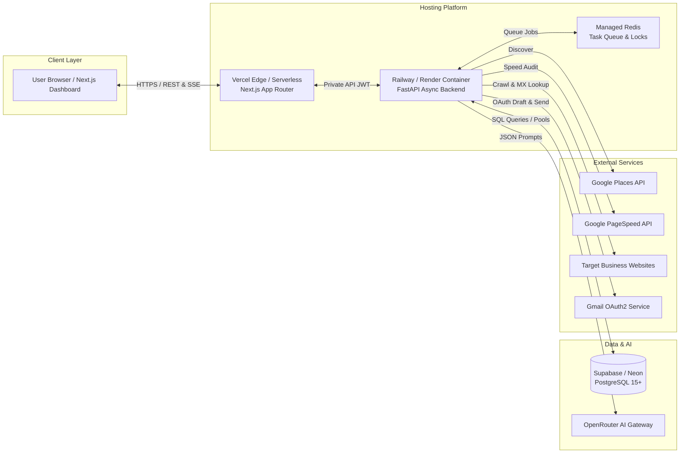

# Technology Stack & Evaluation Report
## LeadForge AI — Architectural Foundation & Technology Selection

---

### 1. Architectural Philosophy

LeadForge AI is engineered with three uncompromising architectural principles:
1. **API Minimalism & Cost Efficiency:** Instead of chaining 5–10 expensive subscription APIs, we use **one unified AI gateway (OpenRouter)** and leverage direct protocol checks (DNS MX, direct HTTP crawl, Google PageSpeed API free tier, Google Places API with aggressive local caching).
2. **Type Safety & Maintainability:** End-to-end TypeScript on the frontend and Python with Pydantic v2 on the backend ensure rigorous validation of scraped data and AI JSON payloads.
3. **Operational Robustness & Compliance:** Asynchronous I/O across scraping and background auditing prevents UI blocking, while strict SSRF filtering ensures host safety.

---

### 2. Full Technology Stack Matrix

| Layer | Recommended Technology | Primary Version | Key Libraries / Modules |
| :--- | :--- | :--- | :--- |
| **Frontend Framework** | **Next.js (App Router)** | 14.x / 15.x | React 18/19, TypeScript 5.x |
| **UI Component Library** | **shadcn/ui** | Latest | Radix UI Primitives, Lucide Icons |
| **Styling** | **Tailwind CSS** | 3.4+ | `@tailwindcss/typography`, `tailwind-merge` |
| **State & Data Fetching**| **TanStack React Query** | 5.x | Optimistic UI updates, caching, pagination |
| **Data Tables** | **TanStack Table** | 8.x | High-performance virtualized CRM lead tables |
| **Backend Framework** | **Python FastAPI** | 0.110+ | Pydantic v2, Starlette, Uvicorn (ASGI) |
| **Database & ORM** | **PostgreSQL + SQLAlchemy** | Postgres 15+, SQLAlchemy 2.0+ | `asyncpg`, Alembic (migrations) |
| **Managed DB Platform** | **Supabase or Neon** | Cloud Postgres | Built-in Auth, Row Level Security, backups |
| **AI Gateway** | **OpenRouter API** | Standard REST/OpenAI SDK | `openai-python` pointing to OpenRouter base URL |
| **HTTP & Web Scraping** | **HTTPX + BeautifulSoup4** | httpx 0.27+, bs4 4.12+ | Async HTTP/2 client, lxml parser |
| **Headless Browser** | **Playwright (Python)** | 1.42+ | Chromium engine for dynamic JavaScript sites |
| **DNS & MX Verification** | **dnspython** | 2.6+ | Asynchronous DNS resolution for MX records |
| **Task Queue & Cache** | **Redis + ARQ / Celery** | Redis 7+, ARQ 0.25+ | Lightweight async job processing & deduplication |
| **Email Sending** | **Gmail API (Google OAuth2)** | Google API Client 2.x | `google-auth-oauthlib`, `google-api-python-client` |
| **Hosting & Deployment** | **Vercel (UI) + Railway/Render** | Cloud Native | Dockerized FastAPI backend, Vercel edge CDN |

---

### 3. Detailed Component Evaluation & Justification

#### 3.1 Frontend: Next.js + React + TypeScript + shadcn/ui

- **Why Next.js App Router?**
  - **Server Components:** Securely fetch initial lead lists without exposing backend internal service tokens to the client.
  - **Optimal Developer Velocity:** Rapid prototyping of interactive dashboards with TypeScript typing.
  - **Streaming & Suspense:** Stream real-time progress of long-running batch website audits into UI progress bars.
- **Why shadcn/ui & Tailwind CSS?**
  - Unlike bloated UI kits (Material UI, Ant Design), shadcn/ui copies accessible Radix primitives directly into the codebase.
  - Complete control over design tokens, zero runtime CSS overhead, native Dark Mode support, and effortless customization for complex CRM tables (data badges, slide-over lead inspection drawers, modal email composers).

#### 3.2 Backend: Python FastAPI

- **Why FastAPI over Node.js/Express/NestJS?**
  1. **Scraping & Data Extraction Ecosystem:** Python remains the undisputed standard for web scraping, HTML parsing (`BeautifulSoup4`, `lxml`), DNS validation (`dnspython`), and headless automation (`Playwright`).
  2. **High-Performance Async I/O:** FastAPI runs on `asyncio` + `uvloop`, allowing 100+ concurrent HTTP website probes, DNS queries, and LLM requests without threading bottlenecks.
  3. **Pydantic v2 Validation:** Direct serialization of complex AI JSON payloads. If an LLM response violates schema requirements, Pydantic catches and validates it before it touches the database.
  4. **Auto-Generated OpenAPI (Swagger):** Instant visual API testing interface at `/docs` during development.

#### 3.3 Database: PostgreSQL + SQLAlchemy 2.0 + Supabase/Neon

- **Why PostgreSQL?**
  - LeadForge AI requires relational integrity (linking a `Business` -> `WebsiteAudit` -> `Contacts` -> `EmailDrafts` -> `Campaigns`) combined with document flexibility (`JSONB` for raw API responses, audit technical metrics, and LLM prompts).
  - PostgreSQL's `JSONB` support allows fast indexing and querying of unpredictable web metadata without schema migrations for minor attributes.
- **Why Supabase or Neon?**
  - **Supabase:** Offers instant PostgreSQL 15, robust Auth, automatic backups, and Row-Level Security (RLS) on a generous free tier ($0/mo for up to 500MB database, more than enough for 50,000 leads).
  - **Alembic:** We use standard code-driven Alembic migrations to ensure the database schema is completely portable and not locked into any proprietary cloud database vendor.

#### 3.4 AI Orchestration: OpenRouter (Single Unified AI Gateway)

- **The Strategic Advantage of OpenRouter:**
  - **Eliminates Vendor Lock-in:** Provides one unified OpenAI-compatible SDK interface (`api.openrouter.ai/v1`) while granting access to Gemini 1.5 Flash, Claude 3.5 Sonnet, GPT-4o, DeepSeek V3, and Llama 3.3.
  - **Zero Multi-Account Overhead:** Instead of maintaining 4 distinct credit balances and API keys across Anthropic, OpenAI, and Google AI Studio, the agency funds a single OpenRouter wallet.
  - **Dynamic Tiering:**
    - *Tier 1 (Fast Classification & Data Extraction):* DeepSeek V3 or Gemini 1.5 Flash at **~$0.07–$0.14 per 1M tokens** (fractions of a cent per lead).
    - *Tier 2 (High-Stakes Business Intelligence & Outreach Personalization):* Claude 3.5 Sonnet or GPT-4o Mini for natural, human-sounding sales letters that convert.
  - **Cost & Token Transparency:** OpenRouter returns exact token usage and financial cost in each API response header, allowing LeadForge AI to track exact unit economics down to the cent per lead.

#### 3.5 Business Discovery: Google Places API + OpenStreetMap Overpass

- **Dual-Layer Discovery Strategy:**
  1. **Google Places API (New):** High data freshness, accurate phone numbers, verified ratings, and official website URLs for local businesses in India and worldwide.
  2. **OpenStreetMap (Overpass API):** Zero-cost query engine for open geospatial data. Excellent for mapping physical establishments (retail clusters, clinics, gyms) without consuming API credits during preliminary exploratory scans.
- **Caching & ToS Compliance:**
  - Google Places API prohibits storing certain data permanently (like caching latitude/longitude indefinitely for re-syndication).
  - LeadForge AI stores the business profile in compliance with Google ToS: Place IDs and core business attributes for internal CRM usage, avoiding illegal public redistribution.

#### 3.6 Website Auditing: PageSpeed Insights API + HTTPX / Playwright

- **PageSpeed Insights API:**
  - Google provides this API **completely free of charge** (up to 25,000 queries per day).
  - It returns authoritative mobile performance scores, First Contentful Paint (FCP), Largest Contentful Paint (LCP), Cumulative Layout Shift (CLS), and SEO audit results without running heavy local Chrome instances on the backend server.
- **Async HTTPX + BeautifulSoup4 (Lightweight Scraper):**
  - Handles 90% of technical audits (status codes, SSL certificate validity, viewport meta tags, social media URL detection, `mailto:` extraction) with millisecond latency and minimal CPU/memory footprint.
- **Playwright (Python Headless Chromium):**
  - Reserved strictly for dynamic, JavaScript-heavy Single Page Applications (React, Vue, Angular) where raw HTML doesn't expose contacts or text.
  - Isolated worker instances with aggressive memory limits (512MB per worker) and short timeouts (8 seconds).

#### 3.7 Contact Discovery & Verification: In-House DNS MX Engine

- **Why In-House Verification instead of 3rd-Party APIs (Hunter/Snov)?**
  - External enrichment APIs charge $0.02 to $0.05 per email lookup, rapidly escalating agency operational expenses.
  - 85%+ of local business emails are prominently listed on their own public contact pages (`/contact`, `/about-us`, site footer) or Google Maps profiles.
  - We use direct, asynchronous DNS resolution (`dnspython`) to verify that the domain has active, valid Mail Exchange (MX) records.
  - This delivers a **100% free, legally sound verification tier** with zero recurring monthly subscription fees.

#### 3.8 Email Sending: Google Workspace / Gmail API (OAuth 2.0)

- **Why Gmail API over Transactional SMTP (SendGrid, Mailgun, Amazon SES)?**
  - **Inbox Deliverability:** Cold outreach from freshly registered SendGrid or Mailgun domains almost universally lands in the spam or promotions tab unless complex domain warming (30–60 days) is completed.
  - **Native Authority:** Sending directly from the agency owner's authenticated Google Workspace address (`you@youragency.com`) via the official Gmail API guarantees highest-tier inbox placement.
  - **Thread Synchronization:** All replies naturally show up in the agency owner's actual Gmail inbox and mobile app, while LeadForge AI monitors thread status via OAuth webhooks or polling.

---

### 4. Hosting & Infrastructure Architecture

---

### 5. Architectural Trade-offs & Decisions Summary

| Decision | Chosen Option | Alternative Rejected | Core Rationale |
| :--- | :--- | :--- | :--- |
| **AI Integration** | OpenRouter (Single API) | Direct OpenAI + Anthropic + Google SDKs | Consolidates billing into 1 wallet, allows dynamic runtime model switching, eliminates multi-SDK code bloat. |
| **Backend Language** | Python (FastAPI) | Node.js (NestJS / Express) | Far superior ecosystem for web scraping, HTML parsing, DNS verification, and headless browser orchestration. |
| **Website Audit** | PageSpeed API + HTTPX | Full local Lighthouse on every site | Running local Lighthouse Chromium instances on a small server crashes CPU and memory; PageSpeed API offloads compute to Google for free. |
| **Email Verification** | In-House DNS MX & Web Crawl | Hunter.io / ZeroBounce | Zero subscription costs; 100% compliant with public data extraction laws; sufficient for local agency leads. |
| **Outreach Delivery** | Gmail API (OAuth2) | SendGrid / Amazon SES | Mass transactional providers trigger spam filters on cold leads; native Gmail API has natural agency deliverability. |
